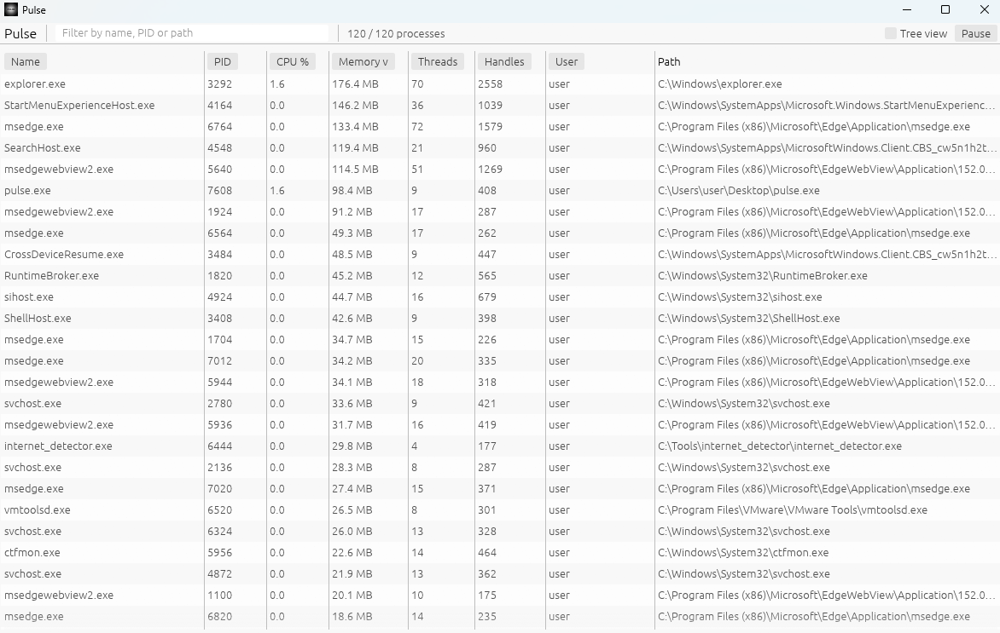

<p align="center">
  
</p>

<h1 align="center">Pulse</h1>

<p align="center">
  A small, fast process explorer for Windows.<br>
  Process Explorer, with Everything-style search.
</p>

<p align="center">
  <a href="#features">Features</a>
  &nbsp;|&nbsp;
  <a href="#keyboard">Keyboard</a>
  &nbsp;|&nbsp;
  <a href="#building">Building</a>
  &nbsp;|&nbsp;
  <a href="#why-rust">Why Rust?</a>
  &nbsp;|&nbsp;
  <a href="#under-the-hood">Under the hood</a>
</p>

<p align="center">
  
</p>

Native Rust and egui. No installer, no driver, no telemetry, and no
undocumented NT calls. Runs without admin rights; protected processes just
show less detail.

## Features

**Find anything fast**
- Live process list, refreshed every second
- Search as you type: fuzzy on names, exact on PIDs and paths
- Sort by any column, or switch to a tree grouped by parent process

**See what a process is doing**
- CPU, memory, private bytes, threads, handles, priority
- Command line, parent, start time, run time
- Open TCP and UDP sockets, IPv4 and IPv6. Hidden behind a dropdown by
  default so addresses stay off screen when sharing or streaming
- New processes are highlighted briefly, heavy CPU users are tinted

**Act on it**
- End a process or a whole process tree, with confirmation and a warning
  for processes Windows can't run without
- Suspend and resume, with suspended processes marked in the list
- Change priority (realtime asks first)
- Open the file location, copy the path or PID

## Keyboard

| Key           | Action                                 |
| ------------- | -------------------------------------- |
| `Up` / `Down` | Move the selection                     |
| `Enter`       | Select the top search result           |
| `Delete`      | End the selected process (asks first)  |
| `Esc`         | Clear the search, or cancel a dialog   |

Right-click any row for the full list of actions.

## Building

Needs a recent stable Rust toolchain on Windows.

```powershell
cargo build --release -p pulse-app
```

The binary is written to `target/release/pulse.exe`. It's a single file and
can be copied anywhere.

## Why Rust?

A process explorer spends its whole life holding raw Windows handles and
reading tables the OS fills in. That's exactly where C and C++ tools tend to
leak handles or read past a buffer. Rust keeps those risks in a few places I
can actually review:

- **`unsafe` stays in one small corner.** Only the three Win32 wrapper files
  in `pulse-core` use it. Everything above them, including the whole UI, is
  safe Rust.
- **Handles can't leak.** Every handle is wrapped in a type that closes it
  when it goes out of scope, so an early return or error can't leave one open.
- **Threads are checked at compile time.** Polling runs on its own thread so
  the UI never stalls, and the compiler rejects any data shared between the
  two that isn't safe to share.
- **One small native exe.** No .NET, no Electron, no installer. The release
  build is a single file of a few MB that starts instantly.
- **Good Windows support.** Microsoft's official `windows` crate covers the
  Win32 APIs with proper error types, and `sysinfo` handles the process
  basics.

## Under the hood

```
crates/
  pulse-core/   snapshots, search, process tree, socket tables, actions
  pulse-app/    egui front end and the polling thread
assets/         icon and screenshot
```

- `pulse-core` has no UI dependencies, and its logic is unit tested
  (`cargo test`).
- Process data comes from `sysinfo` plus one Toolhelp snapshot per tick for
  threads and priority. Sockets come from `GetExtendedTcpTable` and
  `GetExtendedUdpTable`, and are only read while the Network dropdown is open.
- The window only redraws when new data arrives or you interact with it.
  Pausing stops the polling entirely.
- Suspend and resume walk the process's threads with `SuspendThread` and
  `ResumeThread` instead of calling `NtSuspendProcess`.
- Parent links are only trusted when the parent started before the child.
  Windows reuses PIDs, and without that check "End process tree" could reach
  processes that aren't really children.

## License

[MIT](LICENSE)
